# inputland

Control the mouse with hand gestures from a webcam: point to move, pinch to click, open your palms to scroll. Works on Wayland (Hyprland), X11 and the TTY.

   

 

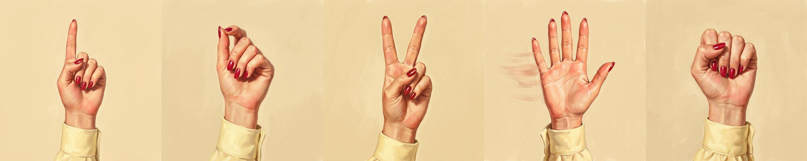

Point with either index finger and the cursor follows the base of that finger, so it stays put while you pinch. A small HUD in the corner shows what each hand is doing.

## Gestures

| Preview | Gesture |
| ------- | ------- |
| 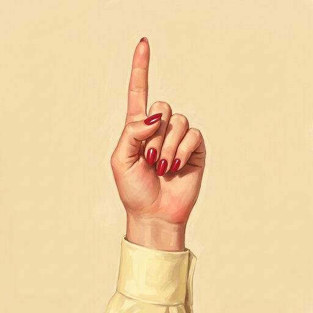 | **Point** with either index finger: move the cursor. Any other pose releases it; if both hands point, the hand already moving the cursor keeps it |
| 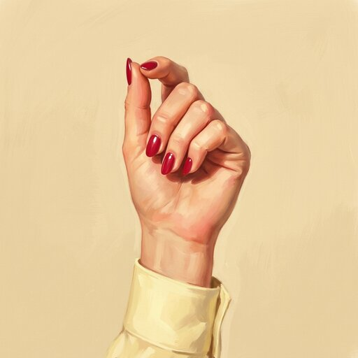 | **Pinch** thumb to index tip while pointing: left click. Pinch twice quickly to double click; hold the pinch and move to drag. Open the pinch before the next one |
| 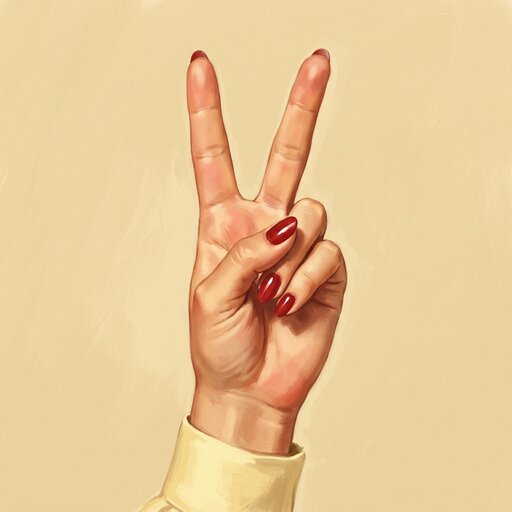 | **Victory**, index and middle finger up: right click |
| 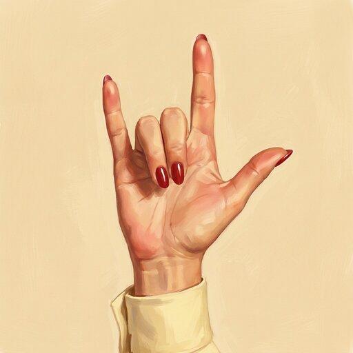 | **Index and pinky out**, thumb either way, held about a second: close the focused window (`hyprctl dispatch` on Hyprland, Alt+F4 elsewhere, nothing on the TTY) |
| 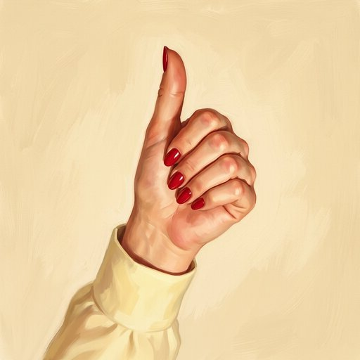 | **Thumbs up**: copy (Ctrl+Insert) |
| 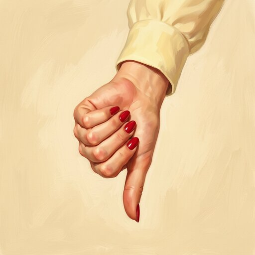 | **Thumbs down**, held a moment: paste (Shift+Insert) |
| 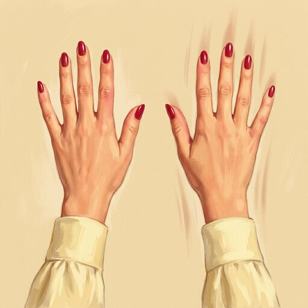 | **Two open palms**: move the pointing hand up / down to scroll, joystick style; spread the palms apart / together to zoom in / out (Ctrl+wheel, so most apps zoom around the cursor). The further, the faster |
| 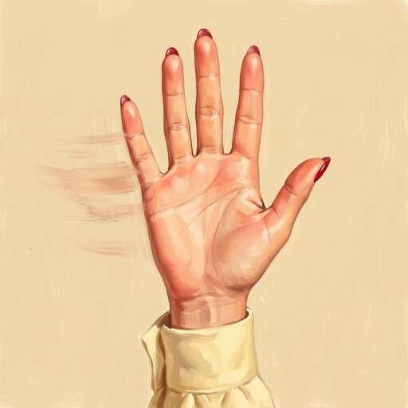 | **One open palm** swiped quickly left / right: next / previous workspace, like Hyprland's touchpad swipe (Hyprland only). While paused: resume |
| 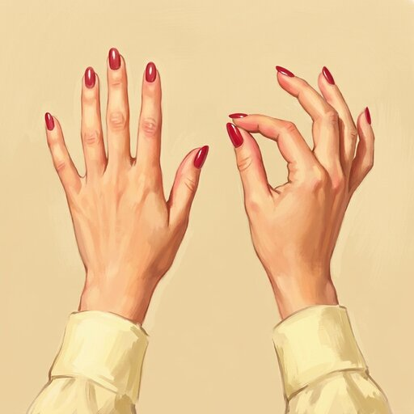 | **One palm open, the other hand pinching**, like grabbing a slider: move the pinch up / down for volume, right / left for brightness, about one step per centimeter |
| 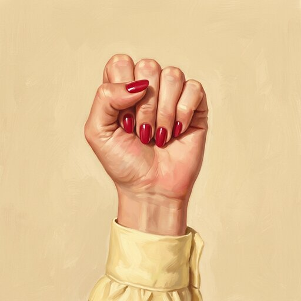 | **Fist** with either hand: pause. The hands are ignored, so you can gesture freely, until you open a palm. **Both fists** held about 2 seconds: quit |
|  | **Index fingertip on your forehead** for half a second: steer the cursor with your head (nose tip, starting at the screen center); again to go back to your hand |

Right click, close, copy, paste, scroll and swipe count only from the hand that last pointed, so a stray pose from the other hand does nothing.
Scroll and zoom: whichever starts first keeps the gesture until you close either hand. Volume and brightness: whichever direction steps first keeps it until you let go of the pinch. They tap the media keys, so your desktop's own bindings make the change and show it (Omarchy shows its OSD). A pinch that was already dragging stays a drag.
Copy and paste use Ctrl+Insert and Shift+Insert because, unlike Ctrl+C, they do not interrupt a terminal; terminals usually paste the selected text (primary selection) on Shift+Insert.
In head mode, pinch, right click and the other gestures still work with the hand, which must stay in the camera's view.

## HUD

A HUD in the top-right corner shows what each hand is doing, in your Omarchy theme colors, or your GTK theme's elsewhere. Clicks pass through it.

| Label | Meaning |
| ----- | ------- |
| `Starting` · `Point to start` · `Not seen` | Loading, no hand in view, this hand out of view |
| `Moving` | This hand moves the cursor (highlighted) |
| `Pointing` | This hand points, but the other one has the cursor |
| `Pinch` | The left button is held (click or drag) |
| `Right click` · `Copy` · `Paste` · `Close` | The action just sent |
| `Scrolling` · `Zooming` | Two open palms |
| `Slider` · `Volume` · `Brightness` | Palm plus pinch |
| `Close...` · `Paste...` · `Head...` · `Head off...` | A hold building up, so you can let go in time |
| `At edge` | The hand is outside the mapped region |
| `Paused` · `Head` | Paused, or in head mode |
| `-` | A pose that does nothing |

When no hand moves the cursor, the one whose gestures count (the last to point) is underlined.

## Install

```sh
git clone https://github.com/Anerti/inputland.git ~/Projects/inputland && cd ~/Projects/inputland
./install.sh            # interactive menu; or ./install.sh install --yes
```

| Command | What it does |
|---|---|
| `./install.sh install` | Installs `gtk4-layer-shell` (pacman) and `uv sync --locked`, adds an `inputland` command in `~/.local/bin` and an app launcher entry, then runs `setup` |
| `./install.sh setup` | Grants `/dev/uinput` access through a `uinput` group and udev rule (not the `input` group, which can read every keyboard), downloads and verifies the models (~12 MB) to `~/.cache/inputland`, checks for a camera |
| `./install.sh uninstall` | Removes the `inputland` command, the launcher entry, `.venv` and the cached models; asks before removing the udev rule and the `uinput` group membership. The source folder is kept |

It needs [uv](https://docs.astral.sh/uv/) and asks for `sudo` only for the package and the permissions. With [gum](https://github.com/charmbracelet/gum) installed (it ships with Omarchy) it shows menus and progress spinners; without it, plain prompts. After the first setup, log out and back in so the group membership applies.

## Usage

```sh
inputland            # run with the HUD (Ctrl+C to quit)
inputland --preview  # camera view with the HUD's text and pinch ratios; green box = active (q/Esc quits)
inputland --no-hud   # headless, e.g. on X11; without a display (TTY) the HUD is skipped anyway
```

Started without a terminal (from the app launcher, where it is listed as *inputland*, or a keybinding), it shows a fatal error as a desktop notification. To start it from a Hyprland keybinding, e.g. `bind = SUPER ALT, H, exec, ~/.local/bin/inputland`.

### Calibration

| Flag | Default | Effect |
|---|---|---|
| `--region L T R B` | `0.25 0.2 0.75 0.7` | Part of the camera frame mapped to the screen. Smaller = less hand travel. |
| `--min-cutoff` | `1.0` | Lower = steadier cursor when still, more lag. |
| `--beta` | `10.0` | Higher = less lag on fast moves, more jitter. |
| `--pinch-ratio` | `0.35` | Thumb-index distance, as a fraction of hand size, that counts as a pinch. Raise if pinches are missed, lower if it clicks on its own; `--preview` shows each hand's ratio. |
| `--scroll-speed` | `80` | Wheel clicks per second for each frame height the hand moves past the dead zone. |
| `--scroll-dead-zone` | `0.03` | Hand travel (fraction of frame height) that does not scroll yet. Raise if it scrolls while you hold still. |
| `--zoom-speed` | `10` | Wheel clicks per second for each unit (log ratio) the gap between the palms changes past the dead zone. |
| `--zoom-dead-zone` | `0.1` | Change in the gap between the palms (log ratio, about a fraction: 0.1 is ~10%) that does not zoom yet. Raise if scrolling turns into zooming. |
| `--swipe-distance` | `0.25` | Sideways travel of one open palm (fraction of the frame width), within about a third of a second, that switches workspace. Lower if swipes are missed, raise if a wave switches workspace. |
| `--slider-step` | `0.013` | Travel of the pinching hand (fraction of the frame) per volume or brightness step. Raise if it jumps several steps at once. |
| `--head-range` | `0.12` | In head mode: nose travel (fraction of the frame) that crosses the whole screen; half of it from where head mode started reaches an edge. Lower = smaller head movements, more jitter. |
| `--camera N` | `0` | Use `/dev/videoN`. |
| `--hud-corner` | `top-right` | Screen corner of the HUD: `top-left`, `bottom-right`, `bottom-left`. |

Tune with `--preview`: hold your hand still and lower `--min-cutoff` until the jitter is gone, then move fast and raise `--beta` until the lag is gone.
Flags are not saved; keep your values in a shell alias, e.g. `alias inputland='inputland --region 0.3 0.25 0.7 0.65'`, or in your keybinding.

With several monitors the region maps onto the whole screen layout, so the same hand movement covers all of them and each monitor gets less precision.

## Architecture

One loop, one direction: **camera → tracking → gesture → mapping/filter → output**.

| Module | Role |
|---|---|
| `camera.py` | OpenCV V4L2 capture, mirrored RGB frames |
| `tracking.py` | MediaPipe `GestureRecognizer` → `Hand` (side, gesture, 21 landmarks), `FaceLandmarker` → face landmarks (head mode); model download |
| `gestures.py` | Pose rules (`is_gesture`, `is_pinching`, `touches_head`, `pick_pointer_hand`) and `Debounce` against single-frame flicker |
| `filters.py` | One Euro filter (jitter vs. lag) |
| `config.py` | `Settings`, `Region` (camera box → screen) |
| `pointer.py` | uinput absolute pointer (evdev), plus the copy/paste, volume and brightness keys and closing the window |
| `app.py` | Main loop wiring the above, what the HUD says (`describe`), calibration preview |
| `hud.py` | GTK4 layer-shell overlay; GTK owns the main thread, the loop runs in a worker thread and sends `Status` updates via `GLib.idle_add` |
| `cli.py` | Argument parsing, logging, exit codes |

New gestures go in `gestures.py`; new outputs (clicks, keys, `hyprctl`) go next to `pointer.py`.

## Tests

```sh
uv run pytest
```

## License

[MIT](LICENSE)
